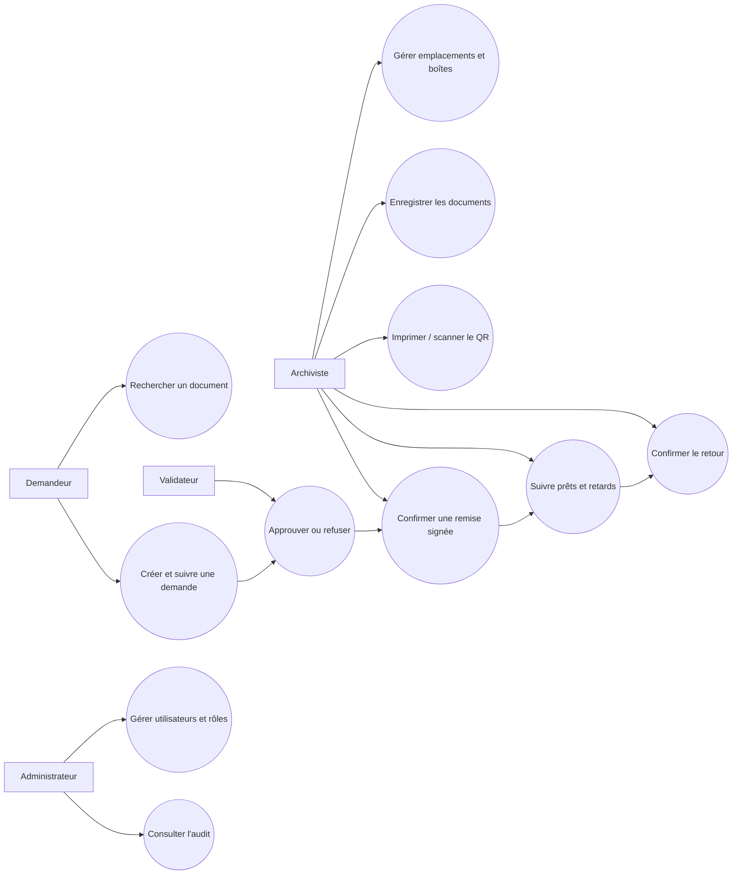
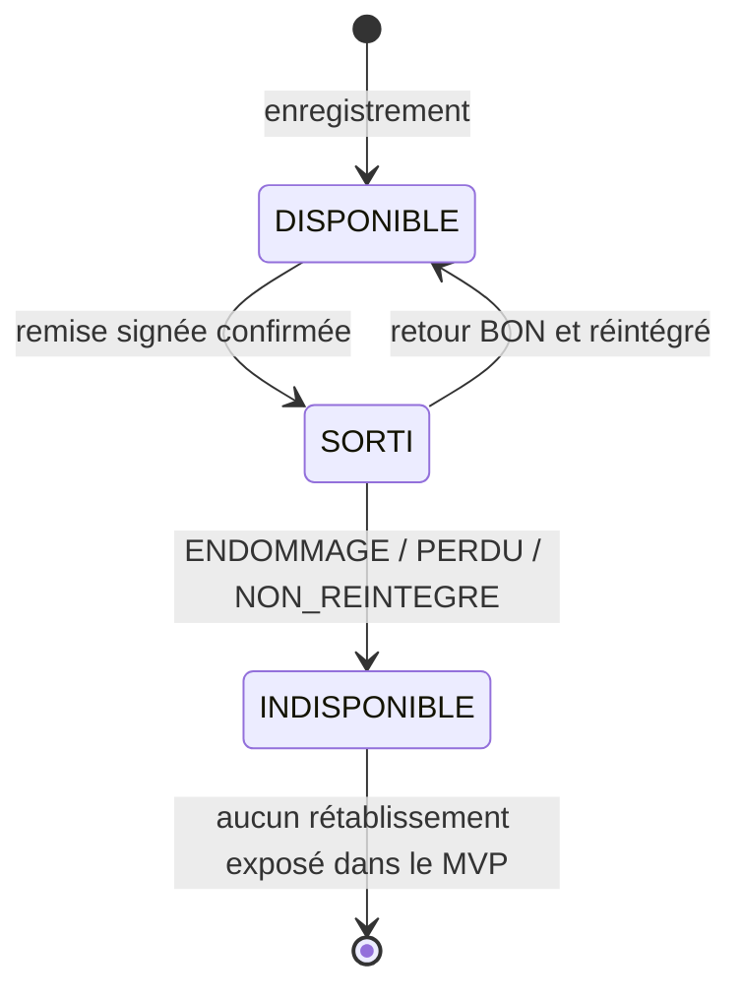
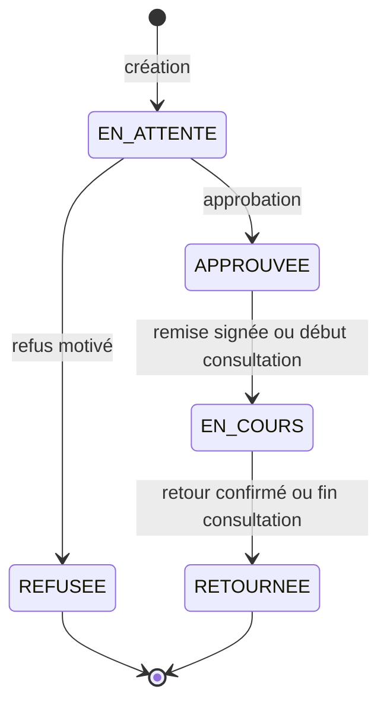
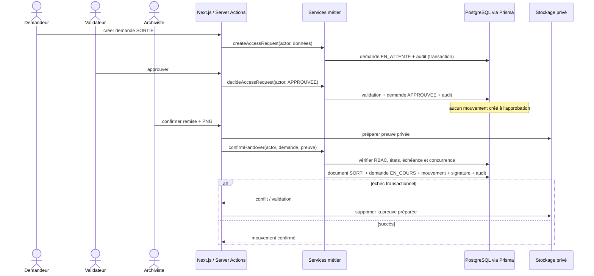
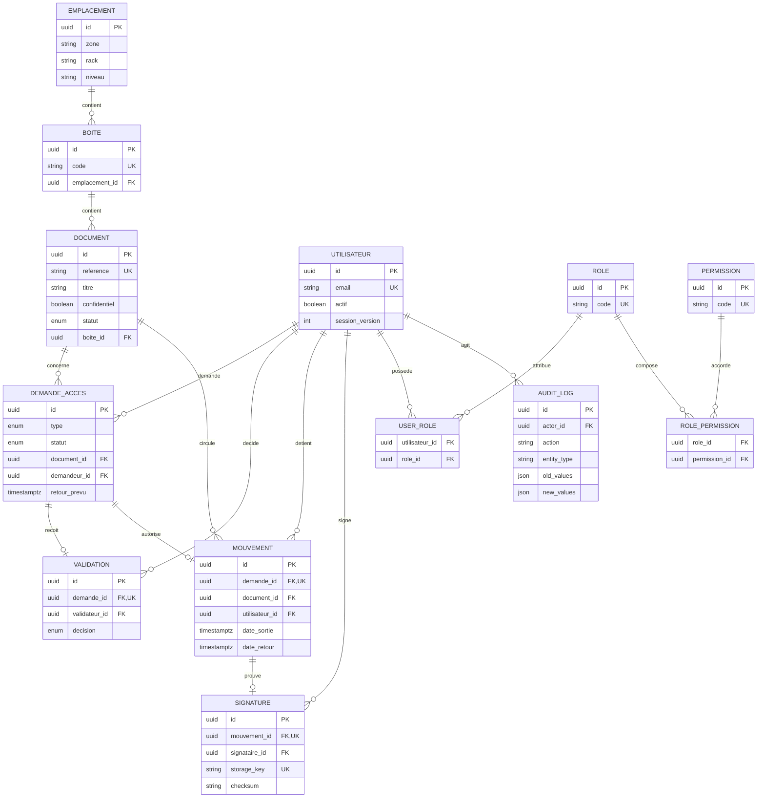
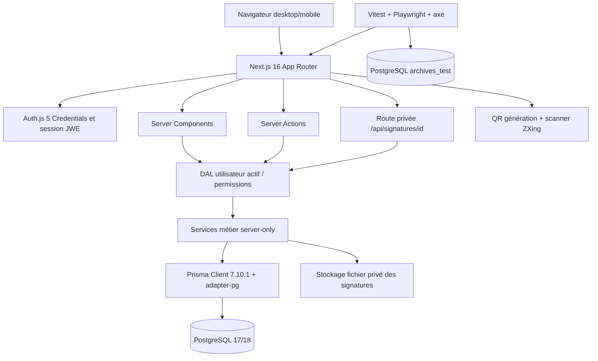

# Architecture et diagrammes

Les diagrammes Mermaid ci-dessous décrivent l'implémentation auditée. Les diagrammes dits « UML » sont des vues de communication ; aucun fichier XMI ni contrôle de conformité UML formelle n'est revendiqué.

## 1. Cas d'usage

## 2. États du document

## 3. États de la demande

## 4. Séquence d'une sortie approuvée

## 5. Modèle entité-relation réel

`LoginAttempt` complète ce modèle pour le contrôle persistant des échecs de connexion. Les relations de consultation sur site relient également une demande à son opérateur archiviste.

## 6. Architecture technique

## 7. Propriétés d'architecture vérifiées

- Les lectures sont principalement des Server Components ; les interactions nécessaires utilisent des composants clients.
- Les Server Actions restent minces et délèguent aux services métier.
- L'autorisation est répétée au plus près des données ; la visibilité d'un bouton n'accorde aucun droit.
- Les décisions, remises et retours utilisent des transactions sérialisables avec nouvelle tentative.
- PostgreSQL garantit unicité, cohérence demande/document, mouvement actif unique et immutabilité audit/signature.
- Les signatures sont hors de `public`, avec clé opaque et contrôle d'intégrité.
- Le stockage fichier et PostgreSQL locaux conviennent à la démonstration mono-instance, pas à une architecture de production distribuée.
