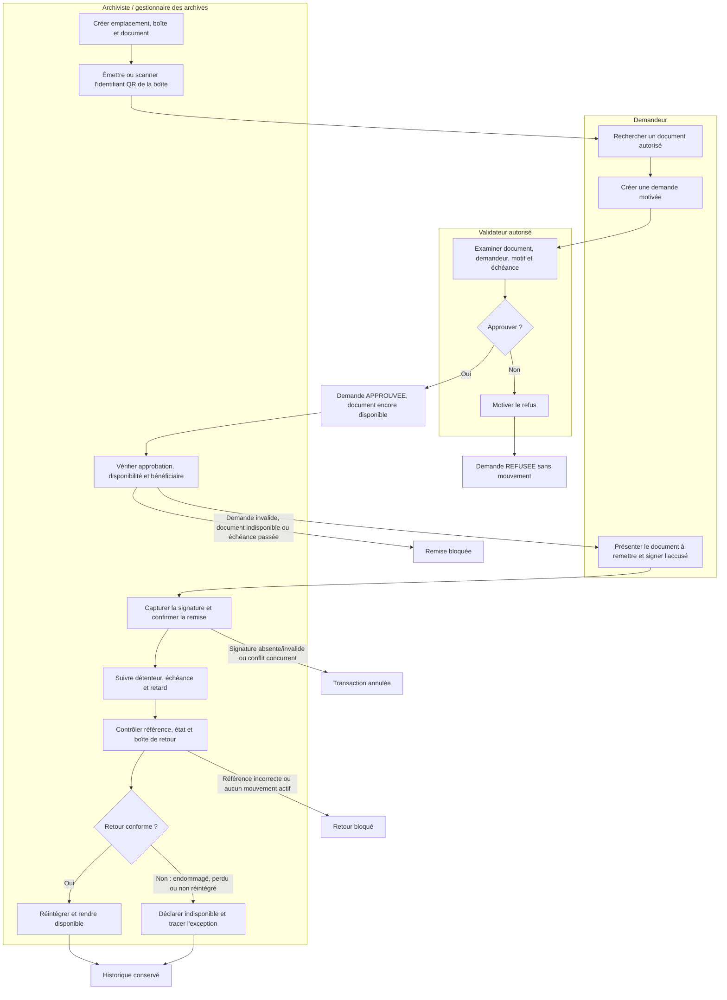

# Processus métier de gestion des archives physiques

## Périmètre et statut du modèle

Le processus décrit la chaîne de garde d'un document physique depuis son enregistrement jusqu'à son retour. Il reflète l'application auditée.

Le cahier des charges original et un modèle AS-IS validé ne sont pas disponibles dans le dépôt. Les éléments AS-IS ci-dessous sont donc des **hypothèses à confirmer**, issues du problème métier décrit dans les documents existants. Le diagramme cible est fourni en Mermaid ; il ne prétend pas être un fichier BPMN 2.0 exécutable ou validé par un moteur BPMN.

## AS-IS — hypothèses à confirmer avec le client

- Les archives sont rangées physiquement dans des boîtes et emplacements connus des archivistes.
- Les recherches, autorisations et sorties peuvent être suivies par des moyens dispersés, ce qui rend la chaîne de garde difficile à démontrer.
- La séparation entre demande, décision et remise physique n'est pas suffisamment explicite.
- Le suivi du détenteur, de l'échéance, de la preuve de remise et du retour nécessite une traçabilité centralisée.
- Les politiques de conservation, destruction, confidentialité fine et traitement des pertes/dommages ne sont pas documentées dans le dépôt.

Ces hypothèses ne doivent pas être présentées comme des constats contractuels sans entretien métier.

## TO-BE — processus pris en charge par le MVP

## Les six étapes métier

### 1. Enregistrement et stockage physique

L'archiviste crée un emplacement unique `zone / rack / niveau`, une boîte à code unique, puis le document à référence unique. Le document est initialement `DISPONIBLE`. L'étiquette QR de la boîte encode une route interne fondée sur son UUID et aucune donnée confidentielle.

### 2. Recherche et demande d'accès

Le demandeur recherche dans son périmètre autorisé, consulte le détail puis crée une demande motivée. Une sortie physique impose une date de retour future. Une consultation sur site est également représentée dans l'application. La demande commence à `EN_ATTENTE`.

### 3. Approbation ou refus

Le validateur examine la demande. Le refus exige un commentaire. L'approbation place la demande à `APPROUVEE`, sans créer de mouvement et sans passer le document à `SORTI`.

### 4. Remise physique signée

Pour une sortie approuvée, l'archiviste contrôle le bénéficiaire, le document, la localisation, la disponibilité et l'échéance. Le bénéficiaire signe sur le canvas. La transaction crée le mouvement et la preuve, passe le document à `SORTI` et la demande à `EN_COURS`.

### 5. Suivi du prêt et des retards

La vue des mouvements expose détenteur, opérateur, date de sortie, retour prévu, retour réel et retard calculé. Les filtres distinguent sorties actives, retards et retours clôturés. Aucun rappel automatique n'est implémenté.

### 6. Vérification et confirmation du retour

L'archiviste retape la référence, choisit l'état physique et la boîte de réintégration. Un retour en bon état clôt le mouvement, passe la demande à `RETOURNEE` et le document à `DISPONIBLE`. Un dommage, une perte ou une non-réintégration exige une observation et place le document à `INDISPONIBLE`.

## Chemin de consultation sur site

Après approbation, l'archiviste peut démarrer puis clôturer une consultation depuis la page des demandes. Le document ne crée pas de `Mouvement` et reste physiquement disponible dans le modèle actuel. Ce chemin est implémenté et audité, mais ne dispose pas d'un scénario automatisé complet de démarrage/clôture. Les exigences de preuve, témoin et durée maximale doivent être confirmées.

## Responsabilités et contrôles

| Acteur | Responsabilité | Contrôles actuels |
| --- | --- | --- |
| Demandeur | Rechercher et demander | Périmètre objet, propriété des demandes, aucune décision/remise |
| Validateur | Approuver ou refuser | Permissions serveur, décision unique, motif de refus obligatoire |
| Archiviste | Stocker, remettre, suivre et retourner | Permissions serveur, transactions sérialisables, contrôles d'état |
| Administrateur | Gérer identités/RBAC et consulter l'audit | Pas de droit métier implicite d'archiviste |

## Exceptions et décisions client

| Exception | Traitement actuel | Décision attendue |
| --- | --- | --- |
| Document déjà sorti ou indisponible | Demande/remise bloquée | Processus de rétablissement d'un document indisponible |
| Demande refusée | Aucune remise possible | Règles d'appel ou de nouvelle demande |
| Signature absente ou invalide | Remise annulée | Valeur probatoire et éventuel prestataire qualifié |
| Retard | Calcul et affichage | Délais, rappels, escalades et destinataires |
| Dommage, perte, non-réintégration | Document indisponible et observation obligatoire | Enquête, responsabilité, photographie et clôture |
| Caméra refusée | Saisie manuelle du code de boîte | Matériel, HTTPS et politique mobile |
| Conflit concurrent | Opération refusée/rejouée de façon contrôlée | Procédure opérationnelle d'arbitrage |
