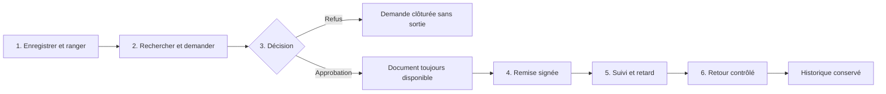

# Processus métier

## Vue d'ensemble

## 1. Enregistrement et stockage

L'archiviste crée un emplacement unique `zone / rack / niveau`, crée une boîte et enregistre chaque document avec une référence unique. Le document est initialement `DISPONIBLE`.

## 2. Recherche et demande

Le demandeur recherche un document dans son périmètre, ouvre son détail et crée une demande motivée. Une sortie exige une date de retour future. La demande devient `EN_ATTENTE`.

## 3. Décision

Le validateur approuve ou refuse. Un refus impose un commentaire. L'identité du validateur et la date sont conservées.

Une approbation change uniquement la demande en `APPROUVEE`. Elle ne signifie pas que le document a quitté le stockage et ne crée aucun mouvement.

## 4. Remise signée

L'archiviste vérifie la demande, la disponibilité, le bénéficiaire, l'échéance et la localisation. Le bénéficiaire signe l'accusé. Une transaction crée le mouvement, fige la preuve, passe le document à `SORTI` et la demande à `EN_COURS`.

## 5. Suivi

L'historique affiche le détenteur, la date de remise, le retour prévu, le retour réel et le retard calculé. Les sorties actives et en retard sont distinguées des simples demandes approuvées.

## 6. Retour

L'archiviste confirme la référence, l'état physique, les observations éventuelles et la boîte de réintégration. Un retour conforme ferme le mouvement, passe la demande à `RETOURNEE` et rend le document `DISPONIBLE`. Une exception le laisse `INDISPONIBLE` selon l'état constaté.

## Règles principales

- le QR identifie une boîte et n'accorde aucun droit de retrait ;
- une demande doit être approuvée avant une remise ;
- approbation et remise sont deux opérations différentes ;
- chaque mouvement concerne un document précis ;
- un document ne peut avoir qu'une sortie active ;
- une signature est obligatoire pour la remise physique ;
- un retour exige un mouvement actif et ne peut être confirmé deux fois ;
- les permissions sont vérifiées côté serveur ;
- mouvements, décisions, signatures et audits ne sont pas supprimés silencieusement.

## Exceptions

| Situation | Comportement |
| --- | --- |
| Document déjà sorti | Nouvelle demande ou remise bloquée |
| Demande refusée | Aucune remise possible |
| Signature absente/invalide | Transaction de remise annulée |
| Retour sans mouvement | Opération refusée |
| Référence de retour incorrecte | Opération refusée |
| Document endommagé/perdu/non réintégré | Observations obligatoires et document indisponible |
| Utilisateur désactivé | Session et opérations protégées refusées |
| QR scanné sans permission | Accès interdit malgré l'identifiant valide |
