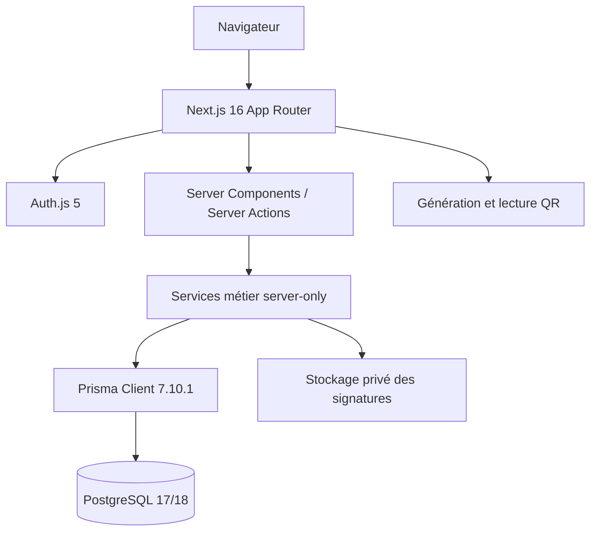

# Architecture technique

## Vue logique

## Application Next.js

Les pages de lecture sont principalement des Server Components. Les composants clients sont réservés aux interactions nécessaires : formulaires avec état, navigation mobile, dialogues, scanner caméra et canvas de signature. Les chargements et erreurs utilisent les conventions App Router.

Les mutations passent par des Server Actions minces. Chaque action récupère l'utilisateur actif puis délègue à un service métier `server-only`. La présence d'un bouton dans l'interface n'est jamais considérée comme une autorisation.

## PostgreSQL et Prisma

Prisma mappe les entités physiques et de sécurité. PostgreSQL impose notamment :

- unicité emplacement, code boîte, référence et e-mail ;
- cohérence mouvement/demande/document ;
- un seul mouvement actif par document ;
- dates de retour cohérentes ;
- immutabilité des signatures et du journal d'audit ;
- suppression restrictive de l'historique.

Les remises, décisions et retours utilisent des transactions sérialisables avec nouvelle tentative sur conflit.

## Authentification et RBAC

Auth.js utilise le fournisseur Credentials, des cookies de session chiffrés et Argon2id. La session contient une version comparée à la version courante du compte : désactivation, changement de mot de passe ou modification critique invalident les sessions précédentes.

Les rôles sont composés de permissions persistées. Les services utilisent `assertPermission`/`hasPermission` et vérifient également `actif = true`.

## Audit

`audit_logs` conserve acteur, action, cible, anciennes/nouvelles valeurs utiles, métadonnées et horodatage UTC. Un déclencheur PostgreSQL interdit mise à jour et suppression. L'interface d'administration est en lecture seule.

## Signatures

Le navigateur produit un PNG limité à 512 Ko. Le fichier est créé avec des permissions privées hors de `public`. La base conserve clé opaque, signataire, SHA-256, type MIME, taille et date. La route `/api/signatures/[id]` exige `signatures.read`, recalcule le checksum et interdit le cache public.

Le stockage fichier convient à une instance locale de démonstration. Un stockage objet privé, chiffré, versionné et sauvegardé est requis avant production.

## QR

L'étiquette contient uniquement l'URL interne de la boîte avec son UUID. Aucun titre, document, utilisateur ou droit n'est encodé. La page de destination réexécute authentification, permission et filtrage de confidentialité.

## Configuration

Les secrets restent dans `.env`, jamais sous un préfixe `NEXT_PUBLIC_`. Les principales variables sont `DATABASE_URL`, `SHADOW_DATABASE_URL`, `TEST_DATABASE_URL`, `AUTH_SECRET`, `AUTH_RATE_LIMIT_SECRET`, `AUTH_URL`, `APP_TIME_ZONE` et `SIGNATURE_STORAGE_DIR`.

Le jeu de démonstration exige `NODE_ENV=development` et `ALLOW_DEMO_SEED=true`. Les connexions des comptes nécessitent en plus `DEMO_LOGIN_ENABLED=true` et un mot de passe reçu via `DEMO_USER_PASSWORD`. Le script refuse une base distante et les collisions avec des références non marquées `DEMO_2026`.
