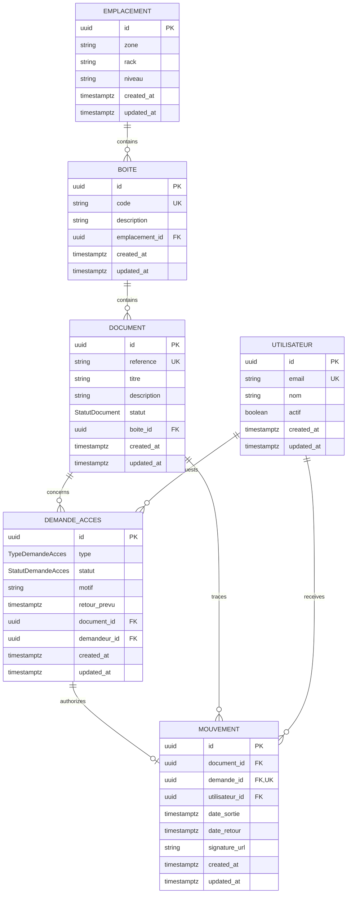

# Database design

This document describes the Step 2 database foundation for the Archives Management System. The design applies records-management principles such as traceability, controlled disposition, and preservation of context. It is inspired by ISO 15489 and leaves room for later digital-preservation work aligned with ISO 14721 (OAIS); it does not claim compliance or certification.

## Runtime and tooling

- Native PostgreSQL 17 or 18 on macOS (Postgres.app or Homebrew)
- Prisma ORM and Prisma Client 7.10.1
- PostgreSQL driver adapter (`@prisma/adapter-pg`)
- Next.js 16 App Router with strict TypeScript
- UUID primary keys and timezone-aware PostgreSQL timestamps

The application connection string is read from the server-only `DATABASE_URL` environment variable. It must never use a `NEXT_PUBLIC_` prefix.

## Entity relationship diagram



## Entities and responsibilities

### Emplacement

Identifies a physical storage position by `zone`, `rack`, and `niveau`. That three-part location is unique. An emplacement may contain many boxes, but cannot be removed while boxes reference it.

### Boite

Represents a physical archive box assigned to exactly one emplacement. `code` is globally unique and is the stable identifier from which a future QR payload may be derived. A QR value should contain only an opaque box code or signed lookup token—never document, user, or authorization data. Scanning identifies a box; it does not authorize a handover.

### Document

Represents one physical archive record and belongs to exactly one box. `reference` is globally unique. Its status defaults to `DISPONIBLE`; later services must control status transitions transactionally rather than exposing unrestricted updates.

### Utilisateur

Represents an application identity without authentication credentials. Email uses PostgreSQL `citext`, making its unique constraint case-insensitive. `actif` defaults to `true`. Authentication, roles, and permissions are intentionally deferred to Step 3.

### DemandeAcces

Records a user's request for one identified document. Approval is represented independently from physical handover. A nullable `retourPrevu` supports consultation/withdrawal terms without inventing a due date when one is not applicable. Each request can have zero or one movement.

### Mouvement

Records the physical handover and later return. `dateRetour` remains null while the document is out. `signatureUrl` is nullable now so signature evidence can be introduced without blocking the initial workflow. It should eventually point to protected object storage rather than contain signature data.

The relation to `DemandeAcces` uses both `demande_id` and `document_id`. Its composite foreign key guarantees that the movement identifies the same document as its request. The unique constraint on `demande_id` prevents multiple handovers for one request. A PostgreSQL partial unique index on `document_id WHERE date_retour IS NULL` prevents more than one open movement for a document.

## Enumerations

`StatutDocument`:

- `DISPONIBLE`: eligible for a new controlled access operation.
- `SORTI`: physically handed over and not yet returned.
- `INDISPONIBLE`: unavailable for reasons outside an active handover.

`TypeDemandeAcces`:

- `CONSULTATION`
- `SORTIE`

`StatutDemandeAcces`:

- `EN_ATTENTE`
- `APPROUVEE`
- `REFUSEE`
- `EN_COURS`
- `RETOURNEE`

## Constraints and deletion policy

- All domain primary keys are database-generated UUIDs.
- Required relations use foreign keys.
- `Emplacement(zone, rack, niveau)`, box code, document reference, and user email are unique.
- A request has at most one movement.
- A movement and its request must reference the same document.
- A document has at most one movement whose `date_retour` is null.
- A populated return timestamp cannot be earlier than its checkout timestamp.
- Domain foreign keys use `ON DELETE RESTRICT`. Historical archive data is never cascade-deleted implicitly.
- Mutable records carry `created_at` and `updated_at`; movement business dates are kept separately.

Hard deletion should later be replaced with an explicit retention/disposition process or soft-deactivation where appropriate. Any exceptional purge should be authorized and audited.

## Indexing choices

- Box by emplacement: inventory for one location.
- Document by box: box contents.
- Document by status: availability searches.
- Request by `(document, status)`: a document's active/history view.
- Request by `(requester, status)`: a user's queue.
- Request by `(status, expected return)`: approval and overdue work queues.
- Movement by `(document, checkout date)`: document movement history.
- Movement by `(user, checkout date)`: custody history.
- Movement by return date: active/return reporting.
- Partial unique open-movement index: concurrency-safe enforcement of one active handover per document.

Indexes are intentionally limited to expected access paths. Query plans and production workload measurements should guide later additions.

## Business-rule enforcement

| Rule | Current enforcement | Required later service behavior |
| --- | --- | --- |
| BR-01 to BR-05 | UUID/unique constraints and required foreign keys | Validate human-facing values and permissions. |
| BR-06 | QR carries identification only | Resolve the code, then independently authenticate and authorize the user. |
| BR-07 | Request and movement are separate records | In one transaction, lock the request/document and allow movement creation only from `APPROUVEE`. |
| BR-08 | Partial unique index permits only one open movement per document | Handle the constraint conflict and re-check document status inside the transaction. |
| BR-09 | Nullable signature reference is available | Require validated signature evidence at the policy-defined workflow point. |
| BR-10 | Movement and request history use restrictive deletion | Add immutable audit events for status changes and privileged actions. |
| BR-11 | Open/returned movement dates are represented | In one transaction, set `dateRetour`, set the request to `RETOURNEE`, and make the document `DISPONIBLE`. |
| BR-12 | Foreign keys and restrictive deletes | Keep all multi-record transitions transactional. |

Database constraints cannot by themselves express the full state machine. Handover and return services must use PostgreSQL transactions and row-level locking (for example, `SELECT ... FOR UPDATE`) so status checks and updates remain atomic under concurrency. Clients must never set request/document statuses directly.

## Planned extensions

- `Role`, `Permission`, and `UserRole`: many-to-many authorization assignments with unique role/permission keys and uniqueness on each user-role pair.
- `Validation`: approver, decision, timestamp, optional comment, and the exact request/version approved. Approval history should be append-only.
- `AuditLog`: actor, action, entity type/id, timestamp, correlation ID, and safe before/after metadata. Restrictive deletion and tamper-evident retention policies will be required.
- `Signature`: movement, signer, storage object metadata, integrity digest, capture timestamp, and evidence policy. The binary should live in protected object storage.
- `DigitalDocument`: archival object metadata, version/fixity, media type, size, storage locator, and relationships to the physical record. Preservation metadata and lifecycle policies should be designed before ingestion.
- `Notification`: recipient, event, channel, delivery state, timestamps, and idempotency key.

Step 3 should add authentication identifiers to `Utilisateur`, define RBAC constraints, record approval decisions, and introduce audit logging before workflow endpoints are exposed.

## Local setup

Prerequisites are Node.js compatible with the installed Next.js/Prisma versions, npm, and a native PostgreSQL server. See [Native PostgreSQL development on macOS](./local-postgresql.md) for installation and secure one-time database creation.

```bash
cp .env.example .env
npm install
npm run db:up
npm run db:status
npm run db:deploy
npm run db:generate
npm run db:check
```

The committed initial migration is applied with `db:deploy`. Use `npm run db:migrate -- --name <change>` only when creating a new migration during local development; never use `prisma migrate dev` in production.

Useful commands:

```bash
npm run db:up        # start Postgres.app or the installed Homebrew service
npm run db:status    # check the native server on 127.0.0.1:5432
npm run db:down      # stop the native server without deleting database files
npm run db:deploy    # apply committed migrations
npm run db:generate  # regenerate Prisma Client
npm run db:check     # test connectivity and verify application tables
npm run db:studio    # inspect development data
```

PostgreSQL listens locally on `127.0.0.1:5432`. The application uses a dedicated, non-superuser `archives` role, and its password lives only in the ignored `.env` file. Stopping the native service preserves all database files. Never remove or reinitialize the PostgreSQL data directory as part of the normal workflow.

## Migration workflow

1. Change `prisma/schema.prisma`.
2. Run `npx prisma format` and `npx prisma validate`.
3. Generate a reviewed development migration with `npm run db:migrate -- --name <change>`.
4. Review generated SQL, especially delete behavior, locks, data conversions, extensions, and custom indexes.
5. Regenerate the client and run the database, TypeScript, lint, and application checks.
6. Commit the schema and migration together; never edit an already-deployed migration.
