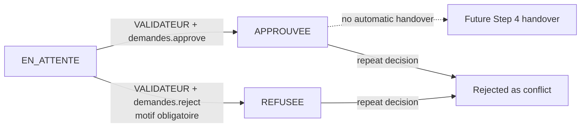

# Step 3 — Authentication, RBAC, authorization, and audit

This step adds identity and approval controls to the Archives Management System. It does not implement physical handover, QR scanning, signature capture, or returns.

## Authentication architecture

Auth.js 5 handles the Credentials provider, encrypted session cookie, CSRF protection, login/logout endpoints, and cookie lifecycle. Credentials are validated with Zod and verified against `Utilisateur.passwordHash` using Argon2id with 19 MiB memory, two iterations, and one lane. There is no public registration route.

The Credentials provider requires Auth.js's JWT session strategy. Sessions therefore use an encrypted JWE cookie rather than Auth.js adapter session tables. The session lasts at most eight hours and contains only the user ID and `sessionVersion`; roles and permissions are never trusted from cookie state.

Every protected Data Access Layer or business-service operation:

1. resolves the Auth.js session;
2. reloads the user from PostgreSQL;
3. verifies `actif = true`;
4. compares the cookie's `sessionVersion` to the current database value; and
5. loads current roles and permissions from the database.

Deactivation, password replacement, user-role changes, and role-permission changes increment `sessionVersion`, invalidating all older sessions on their next protected access. Authorization services also query current RBAC state directly, so a stale page or visible button never grants access.

The application deliberately does not rely on a Next.js Proxy as its security boundary. Pages check access at their leaf entry point, while every Server Action and business service repeats authentication and authorization close to the data. This follows Next.js's guidance for partial rendering and Server Action security.

## Login rate limiting

Failed attempts are stored in `login_attempts`. The key is an HMAC-SHA-256 of normalized email plus client IP, using `AUTH_RATE_LIMIT_SECRET`; plaintext identifiers and passwords are not stored. Five failures in a 15-minute window cause a 15-minute block. Successful authentication clears that key.

Production proxies must replace untrusted forwarding headers and provide a reliable client address. For stronger distributed abuse protection, a managed edge/WAF limiter can supplement—not replace—the database limiter.

## Roles and permission matrix

Permissions are database records connected to roles through `RolePermission`. Users may have multiple roles through `UserRole`.

| Capability | ADMIN | ARCHIVISTE | VALIDATEUR | DEMANDEUR |
| --- | :---: | :---: | :---: | :---: |
| `users.read/create/update/assign_roles/activate` | ✓ |  |  |  |
| `roles.read/update` | ✓ |  |  |  |
| `audit.read` | ✓ |  |  |  |
| `configuration.manage` | ✓ |  |  |  |
| `archives.read` |  | ✓ |  | ✓ |
| `archives.create/update` |  | ✓ |  |  |
| `demandes.create/read_own` |  |  |  | ✓ |
| `demandes.read_all` |  | ✓ | ✓ |  |
| `demandes.approve/reject` |  |  | ✓ |  |
| `validations.read` |  |  | ✓ |  |
| `mouvements.prepare/confirm_return/read` |  | ✓ |  |  |

System roles cannot be deleted through the application. Critical administrative permissions cannot be removed from `ADMIN`. Serializability checks prevent deactivating or removing the ADMIN role from the last active administrator.

## Prisma changes

`Utilisateur` now has:

- nullable `passwordHash`, preserving Step 2 users until an administrator sets a password;
- `sessionVersion` for immediate session revocation;
- `passwordChangedAt` and `lastLoginAt`; and
- relations to roles, validations, and audit entries.

New models:

- `Role`, `Permission`, `UserRole`, and `RolePermission` for scalable RBAC;
- `Validation` for one immutable decision per request;
- `AuditLog` for append-only security/business history; and
- `LoginAttempt` for persistent login throttling.

Migration `20261026141309_step3_auth_rbac_audit` is additive and retains existing records and foreign keys. The migration adds a rejection-comment constraint and a PostgreSQL trigger that rejects `UPDATE` and `DELETE` on `audit_logs`. An approved DBA may disable the trigger only for an explicitly governed retention operation.

## Approval workflow



The decision service runs in a serializable Prisma transaction. It rechecks the validator's current permission, request state, existing validation, document relationship, and—in the approval path—document availability. A conditional update changes only `EN_ATTENTE`; then the service creates `Validation` and `AuditLog` before committing. A unique `Validation.demandeId` is a second concurrency barrier. Approval never creates a `Mouvement`.

Request ownership is enforced server-side. Callers with `demandes.read_own` are filtered by the authenticated user ID; a client-supplied user ID is never accepted as identity.

## Audit model

Audited operations include user creation, activation/deactivation, password replacement, role assignment/removal, role-permission changes, administrator bootstrap, approval, and rejection. Entries contain actor, action identifier, target type/ID, timestamp, relevant old/new values, and structured metadata.

The centralized writer recursively removes keys resembling passwords, hashes, tokens, credentials, secrets, or sessions. The UI exposes only a permission-protected read path; there are no audit mutation actions or endpoints. Database triggers provide defense in depth against modification and deletion by the application role.

## Environment variables

| Variable | Purpose |
| --- | --- |
| `DATABASE_URL` | PostgreSQL connection string. |
| `AUTH_SECRET` | Auth.js JWE/cookie secret; generate at least 48 random bytes. |
| `AUTH_RATE_LIMIT_SECRET` | Independent HMAC secret for login-attempt keys. |
| `AUTH_URL` | Canonical HTTPS origin in production. |
| `AUTH_TRUST_HOST` | Set to `true` only behind correctly configured trusted proxy headers. |
| `BOOTSTRAP_ADMIN_NAME` | One-time first administrator name. |
| `BOOTSTRAP_ADMIN_EMAIL` | One-time first administrator email. |
| `BOOTSTRAP_ADMIN_PASSWORD` | One-time first administrator password; never commit it. |
| `TEST_DATABASE_URL` | Dedicated integration database whose name contains `_test`. |

`AUTH_SECRET` and `AUTH_RATE_LIMIT_SECRET` must be different values stored in a secret manager outside development. Neither uses a `NEXT_PUBLIC_` prefix.

## Setup and secure bootstrap

```bash
cp .env.example .env
openssl rand -base64 48  # put the result in AUTH_SECRET
openssl rand -base64 48  # put a different result in AUTH_RATE_LIMIT_SECRET
npm install
npm run db:up
npm run db:deploy
```

The seed refuses to finish when no active administrator exists and bootstrap values are absent. To avoid placing the initial password in shell history, use a silent prompt:

```bash
read -r "BOOTSTRAP_ADMIN_NAME?Administrator name: "
read -r "BOOTSTRAP_ADMIN_EMAIL?Administrator email: "
read -rs "BOOTSTRAP_ADMIN_PASSWORD?Administrator password: "; echo
export BOOTSTRAP_ADMIN_NAME BOOTSTRAP_ADMIN_EMAIL BOOTSTRAP_ADMIN_PASSWORD
npm run db:seed
unset BOOTSTRAP_ADMIN_NAME BOOTSTRAP_ADMIN_EMAIL BOOTSTRAP_ADMIN_PASSWORD
npm run dev
```

The seed is idempotent for roles, permissions, and mappings. Once an active administrator with a password exists, later seed runs do not replace administrator credentials.

## Routes

- `/login`: accessible login form with generic credential errors and pending state.
- `/dashboard`: authenticated landing page shaped by current permissions.
- `/administration/utilisateurs`: search, create, role assignment, activation, and password replacement.
- `/administration/roles`: protected role-permission matrix.
- `/validations`: pending decisions and immutable decision history.
- `/administration/audit`: read-only searchable audit viewer.
- `/interdit`: authorization-denied screen.

## Testing

Unit tests do not need PostgreSQL. Integration tests require a dedicated migrated database; the runner refuses to enable them unless its database name contains `_test`.

```bash
createdb archives_test
TEST_DATABASE_URL="postgresql://USER@localhost:5432/archives_test?schema=public" \
  DATABASE_URL="postgresql://USER@localhost:5432/archives_test?schema=public" \
  npm run db:deploy
TEST_DATABASE_URL="postgresql://USER@localhost:5432/archives_test?schema=public" \
  npm run test:run
dropdb archives_test
```

Tests cover password hashing, invalid and inactive credentials, missing/stale sessions, permission denial, validator decisions, rejection reasons, duplicate/reversed decisions, request ownership, role propagation, deactivation revocation, atomic audit creation, concurrent decisions, no handover on approval, and database-level audit immutability.

## Security considerations and remaining limitations

- Enforce HTTPS, secure proxy headers, secret rotation, database least privilege, backups, monitoring, and centralized alerting in production.
- Auth.js 5 is currently distributed under its beta tag; pin upgrades and rerun the security suite before updating.
- The application currently provides administrator-driven password replacement, not self-service recovery or MFA. Enterprise SSO, MFA, forced first-login password change, and password-compromise screening should be evaluated before production rollout.
- The built-in limiter is intentionally simple. High-volume or multi-region deployments should add an edge-grade distributed limiter.
- Audit retention/export policy, legal holds, and privileged DBA operations require organizational governance outside application code.
- Step 4 must implement handover, signed acknowledgment, loan tracking, overdue handling, and transactional return confirmation without weakening these authorization boundaries.
