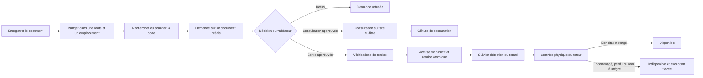

# Étape 4 — Workflow métier des archives physiques

## Périmètre

Cette étape met en œuvre la chaîne de garde d'un document physique : enregistrement, rangement, recherche, demande nominative, décision, remise signée, suivi et retour. Elle applique des principes utiles d'ISO 15489 (identification unique, métadonnées cohérentes, responsabilité et traçabilité), sans revendiquer une certification ni une conformité complète.

Les exigences du cahier des charges sont les contrôles d'accès, la demande sur un document précis, la décision préalable, la preuve de remise, le suivi et la conservation de l'historique. Les états d'exception, la consultation sur site et le stockage privé local de signatures sont des propositions d'implémentation à valider avec le client.

## Processus métier



Un scan QR identifie uniquement la boîte. Il ne crée ni demande, ni autorisation, ni mouvement.

## Cycles de vie

### Document

- `DISPONIBLE` : rangé et éligible à une demande.
- `SORTI` : une remise physique active existe.
- `INDISPONIBLE` : exception constatée au retour (endommagé, perdu ou non réintégré). Une décision métier est nécessaire avant toute remise à disposition.

La suppression de document n'est pas exposée dans l'application. Les relations PostgreSQL sont en `RESTRICT`, ce qui protège les demandes et mouvements existants.

### Demande

Les transitions autorisées sont centralisées dans `modules/demandes/transitions.ts` :

```text
EN_ATTENTE → APPROUVEE → EN_COURS → RETOURNEE
          ↘ REFUSEE
```

Une approbation ne crée jamais de mouvement. Pour une sortie, `EN_COURS` commence lors de la remise signée. Pour une consultation, il commence quand l'archiviste remet le document dans la salle de consultation et se termine à sa restitution sur place.

### Mouvement physique

Le mouvement débute après contrôle d'une demande `SORTIE` approuvée, d'un document disponible, de l'absence de mouvement actif et d'une date de retour future. Il conserve le bénéficiaire, l'opérateur, les dates, l'accusé signé, puis l'opérateur et l'état du retour. Le retour clôt le mouvement sans le supprimer.

## Rôles et responsabilités

- Demandeur : recherche les documents non confidentiels autorisés, crée une demande et suit ses demandes.
- Validateur : approuve ou refuse; il ne remet pas automatiquement le document.
- Archiviste : gère emplacements, boîtes et documents; effectue les remises, consultations et retours; consulte les preuves signées.
- Administrateur : gère utilisateurs, rôles, permissions et audit. Il n'obtient pas implicitement les droits métier d'archiviste.

Les autorisations sont contrôlées côté serveur. Les documents confidentiels sont filtrés au niveau objet : seuls les acteurs possédant `archives.update` peuvent les voir. Deviner une URL ne contourne pas ce contrôle.

## Stockage physique et QR

Un emplacement est la combinaison unique `zone / rack / niveau`. Les codes de boîte et références documentaires sont uniques. Chaque boîte dispose d'un UUID stable. L'étiquette encode une URL interne `/boites/{uuid}` sans titre, référence documentaire ou donnée confidentielle. La page cible exige une session et `archives.read`; son contenu est ensuite filtré selon les droits.

Le scanner demande la caméra après action explicite. La saisie du code de boîte est disponible si la caméra est refusée ou absente. En production, la caméra mobile exige généralement HTTPS.

## Accusé manuscrit

La signature est capturée dans le navigateur au format PNG (souris, tactile ou stylet), avec possibilité d'effacer et recommencer. Le fichier est validé, limité à 512 Ko et placé en zone privée avant la transaction. La transaction crée le mouvement, lie la preuve et modifie les états; en cas d'échec, le fichier préparé est supprimé.

La base conserve une clé privée, le signataire, l'horodatage UTC, le type MIME, la taille et le SHA-256. Les lignes de signature sont immuables via un déclencheur PostgreSQL. La récupération passe par une route authentifiée exigeant `signatures.read`; aucun répertoire public ni URL de stockage n'est exposé. Le checksum est revérifié à la lecture.

Cette capture constitue un accusé interne manuscrit. Elle n'est pas présentée comme une signature électronique qualifiée.

## Cohérence, concurrence et audit

Les remises et retours utilisent des transactions sérialisables avec nouvelle tentative sur conflit. Les mises à jour conditionnelles empêchent une double confirmation. L'index partiel unique `mouvements_document_actif_key` garantit au niveau PostgreSQL un seul mouvement sans date de retour par document. La clé étrangère composite mouvement/demande garantit que les deux désignent le même document.

Chaque création ou modification métier écrit un événement dans `audit_logs` au sein de la même transaction. Les signatures et le journal sont append-only. Les timestamps sont stockés en UTC et affichés dans `APP_TIME_ZONE` (par défaut `Africa/Casablanca`). Le retard est calculé à la lecture; aucun job de fond n'est nécessaire.

## Évolution de la base

La migration additive `20261026151833_step4_archives_workflow` ajoute les métadonnées de classification/confidentialité, le traitement séparé des consultations, les opérateurs et informations de retour, l'entité `Signature`, les contraintes et les index de recherche. Elle ne supprime ni table, ni colonne, ni donnée. L'historique de migrations existant est conservé.

## Scénarios automatisés

La suite Vitest couvre les 20 contrôles demandés : unicité des références, boîtes et emplacements; accès QR et documents confidentiels; demandes valides/invalides; approbation et disponibilité avant remise; double remise concurrente; preuve obligatoire; changement d'états; retard; retour et double retour; préservation de l'historique; audits; rollback atomique; cohérence demande/document; RBAC demandeur/archiviste.

## Exceptions et décisions à confirmer

- Définir qui peut rétablir un document `INDISPONIBLE` et le processus d'enquête pour perte ou dommage.
- Confirmer si une consultation sur site nécessite elle aussi un accusé, un témoin ou une durée maximale.
- Confirmer la valeur juridique attendue de la signature et, si nécessaire, choisir un prestataire de signature qualifiée.
- Définir les durées de conservation des signatures, audits et données personnelles, ainsi que la procédure DBA contrôlée de purge.
- Choisir en production un stockage objet privé chiffré avec sauvegardes, versioning et politique de rétention; le stockage fichier local convient au développement mono-instance.
- Confirmer les règles de confidentialité plus fines (service, dossier, habilitation nominative) si `archives.update` est trop large.
- Définir les règles d'escalade et notifications de retard avant d'ajouter courriels ou tâches planifiées.
- Définir la capacité des boîtes, le récolement périodique et les règles de transfert/destruction documentaire.

## Pistes pour l'étape 5

Ajouter les notifications configurables, rapports d'activité, récolement par campagne, stockage objet géré, politiques de conservation et habilitations par fonds. Une évolution OAIS peut préparer les archives numériques, mais ne doit pas être confondue avec ce workflow physique.
